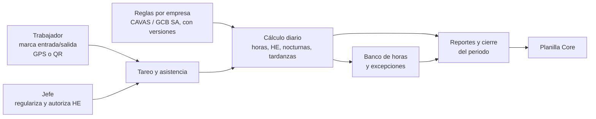

# Sistema de Planillas GCB — Informe de avance (Sprints 1 a 3)

**Para:** José (Gerente General, Grupo Cordillera Blanca) · Germán (Product Owner)
**Fecha:** 30 de octubre de 2026 · **Estado:** Sprint 3 en curso

---

## 1. Objetivo del sistema

El Sistema de Planillas GCB es el **módulo de tareo y asistencia** del grupo: registra cuándo entra y sale cada trabajador, calcula horas ordinarias, horas extra, nocturnas y tardanzas, y entrega esos totales a **Planilla Core**, que es donde se calcula y paga la planilla.

- **Primero CAVAS SAC**: es la empresa piloto y la que tiene las reglas más exigentes (turnos que pasan la medianoche).
- **Después GCB SA**: usa la misma plataforma con su propia configuración de reglas, sin volver a desarrollar.

## 2. Qué se entregó por sprint

### Sprint 1 — Plataforma base (terminado)
- Aplicación web con **ingreso por correo y contraseña**.
- **Cuatro roles**: trabajador, jefe, RRHH y administrador; cada uno ve y hace solo lo que le corresponde.
- **Auditoría**: queda registro de quién cambió qué y cuándo.
- **Datos maestros**: empresas, unidades, trabajadores y tipos de contrato (FT, PT85, PT102).
- **Reglas versionadas por empresa**: tolerancias, horas extra, horario nocturno, etc. se configuran sin tocar programación y cada cambio queda como una nueva versión con fecha de vigencia.

### Sprint 2 — Tareo y asistencia (terminado)
- **Marcación desde el celular** por ubicación GPS (dentro del perímetro del local) o por código QR.
- Turnos y horario semanal por trabajador, incluidos turnos que cruzan la medianoche.
- **Tardanzas**: hasta 10 minutos se perdona; si se pasa, se cuenta completa.
- **Día operativo CAVAS** con corte a las 06:00 (una salida de madrugada pertenece al día que empezó). GCB SA usa día calendario.
- Cálculo diario automático y **bandeja de regularización** para que el jefe corrija marcas olvidadas.

### Sprint 3 — Control y cierre (en curso)
Ya construido en el sistema (servidor):
- **Banco de horas**: saldo, historial, vencimientos próximos y registro de descansos compensados.
- **Excepciones**: faltas sin justificar, tardanzas recurrentes, marcas fuera del perímetro y part-time en riesgo.
- **Bono nocturno 3 AM**: registro con aprobación por otra persona (quien registra no aprueba).
- **Base de reportes y cierre**: consolidado mensual, conceptos para Planilla Core y cierre/reapertura del periodo (primera versión, sin pantallas aún).
- **Pantallas de marcas**: “Mis marcas” para el trabajador y “Marcas” para jefe/RRHH, con filtros por fecha, unidad y trabajador.
- **Datos de demostración automáticos** al iniciar el sistema vacío, para pruebas y demos.

## 3. Reglas de negocio confirmadas

| Tema | Regla |
|---|---|
| Horas extra | Solo cuentan si el jefe las **autorizó antes**. CAVAS las **paga**; GCB SA las **compensa** con descanso (banco de horas). |
| Horas nocturnas | Franja 22:00–06:00, **siempre se calculan**. En CAVAS el recargo nocturno se muestra por separado. |
| Bono nocturno 3 AM | Beneficio **interno**; el monto lo define administración. |
| Part-time (PT85 / PT102) | Alerta si el promedio semanal supera **4 horas por día** (riesgo de perder la condición part-time). |
| Periodo | **Mes calendario**. |
| Tardanza | Tolerancia de 10 minutos. |

## 4. Calidad

- **135 pruebas automáticas pasando** (pytest, corrida del 30/10/2026) en 19 archivos de pruebas del servidor, incluidas pruebas con casos reales de cálculo, permisos por rol y cruce de medianoche.
- **Integración continua (CI)**: en cada cambio se revisan automáticamente estilo de código, migraciones de base de datos, todas las pruebas con medición de cobertura y la compilación de la aplicación web.

## 5. Estado de las entregas (Pull Requests)

| PR | Contenido | Estado |
|---|---|---|
| #1 | Sprint 1 — plataforma | Abierto, pendiente de revisión y aprobación |
| #2 | Sprint 2 — tareo y asistencia | Abierto, pendiente de revisión y aprobación |
| #3 | Sprint 3 — banco de horas, excepciones, marcas | Abierto, en curso |

Ninguno está integrado aún a la versión principal. Recomendamos revisarlos y aprobarlos en orden (1 → 2 → 3).

## 6. Próximos pasos

1. Pantallas de **excepciones** y **bolsa de horas** para jefes y RRHH.
2. **Reportes** y **exportación a Planilla Core** (formato acordado, Excel y conexión directa).
3. **Cierre de periodo** con pantalla y bloqueo de cambios posteriores.
4. **Modo sin conexión** para marcar donde no hay señal y enviar luego.
5. Revisión técnica de refuerzo de pruebas (pasada TDD) antes del piloto.

## 7. Decisiones pendientes de gerencia

1. **Refrigerio de 45 minutos para part-time**: ¿aplica igual que a tiempo completo? (hoy el sistema asume 45 min).
2. **Jornada contractual por trabajador**: confirmar si cada trabajador tendrá su propia jornada o se usa la del tipo de contrato.
3. **Validación legal del acuerdo de compensación** de horas extra en GCB SA (debe existir acuerdo escrito).
4. **Servidor (VPS) y dominio** para el piloto en CAVAS: aprobar proveedor y presupuesto.

## 8. Riesgos

| Riesgo | Impacto | Mitigación |
|---|---|---|
| PRs sin revisar se acumulan | Retraso del piloto y cambios más difíciles de integrar | Agendar revisión de los PR #1–#3 |
| Compensación de HE sin respaldo legal | Contingencia laboral en GCB SA | Validación legal antes de activar |
| Part-time que excede 4h/día | Reclasificación a tiempo completo | Alerta ya construida; definir quién la atiende |
| Sin servidor ni dominio | El piloto no puede iniciar | Decisión de infraestructura este mes |
| Zonas sin señal o GPS impreciso | Marcas fallidas o fuera de perímetro | Modo sin conexión y QR como alternativa |
| Formato de Planilla Core no cerrado | Retrabajo en la exportación | Acordar formato con el equipo de Planilla Core |
